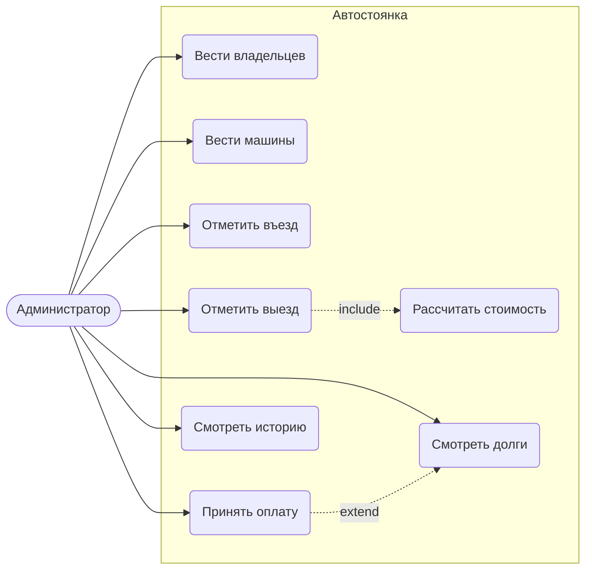
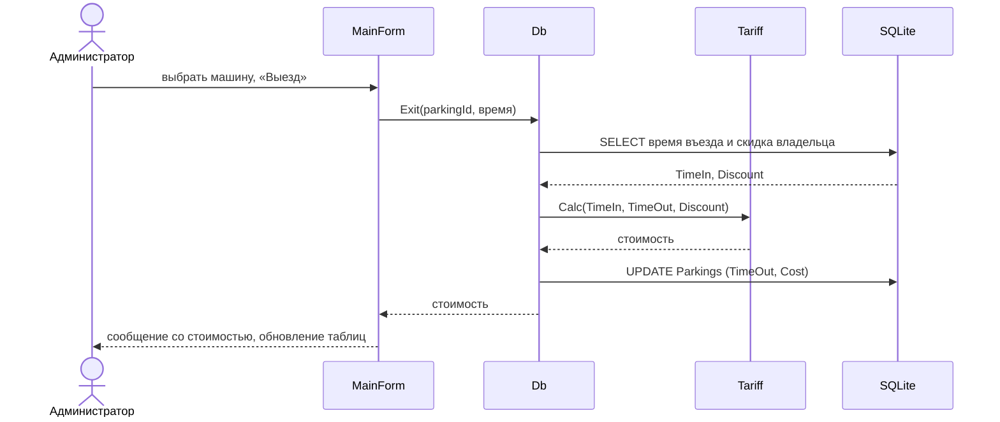
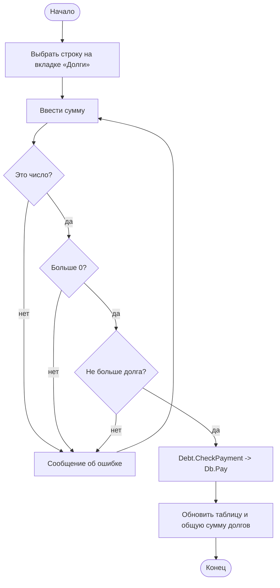
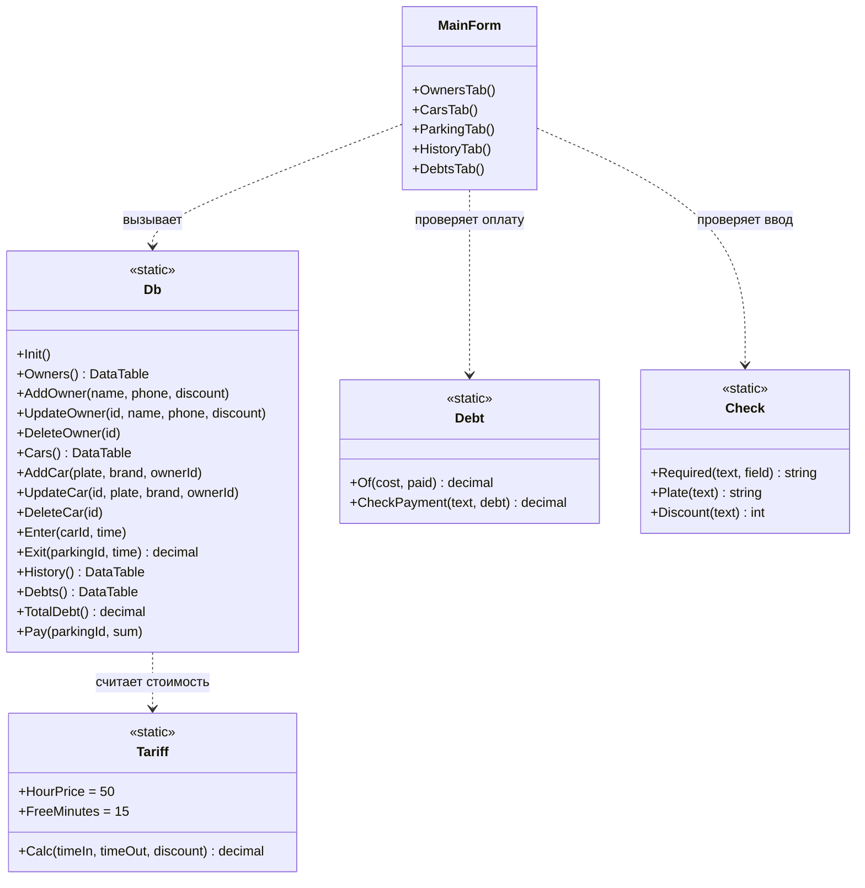
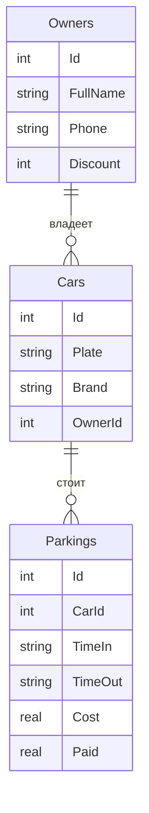

# Лабораторная работа №2. UML-модель проекта
Вариант 14. Модуль «Автостоянка».

**Цель:** разработать систему требований и UML-модель проекта (диаграммы использования, последовательности, активности и классов) и связать её с кодом на C#.

> Диаграммы написаны в формате Mermaid: GitHub и Visual Studio Code показывают их как картинки. В методичке для этого используется Modeling Project в Visual Studio 2013; в новых версиях Visual Studio нет проекта моделирования, поэтому модель оформлена текстом.

## 1. Система требований
По группам из методички (ITILv3).

| Группа | Требование |
|---|---|
| Функциональные | Вести владельцев (ФИО, телефон, скидка) и машины (госномер, марка, владелец) |
| Функциональные | Отмечать въезд и выезд, фиксировать время |
| Функциональные | Считать стоимость: 50 руб. за начатый час, 15 минут бесплатно, минус скидка владельца |
| Функциональные | Вести долги, принимать оплату, показывать общую сумму долгов |
| Функциональные | Показывать историю всех стоянок |
| Управленческие | Данные хранятся в одном файле `parking.db`; копия файла = резервная копия |
| Эргономические | Пять вкладок, русский язык, понятные сообщения об ошибках |
| Архитектурные | Расчёты (`Tariff`, `Debt`, `Check`) не зависят от окна и базы данных |
| Взаимодействия | Внешних систем нет, обмен только с SQLite |
| Сервисного уровня | Любое действие не дольше 1 секунды; неверный ввод не записывается в БД |

## 2. Диаграмма использования (Use Case)

## 3. Диаграмма последовательности: выезд машины

## 4. Диаграмма активности: приём оплаты

## 5. Диаграмма классов

Класс `Db` разбит на три файла (`Db.cs`, `Db.Parking.cs`, `Db.Debts.cs`) через `partial`, а `MainForm` — на `MainForm.cs`, `MainForm.Parking.cs`, `MainForm.Debts.cs`.

Диаграмма данных (таблицы из `docs/schema.sql`):

## 6. Связь модели с кодом
Код программы написан по этой модели вручную: автогенерации кода из модели в Visual Studio 2022 нет. Каждый класс диаграммы соответствует файлу в `src/Parking`; методы совпадают по названиям. Доработка кода после генерации (из методички) заменена обычной разработкой, рефакторинг — выделением расчётов `Tariff`, `Debt`, `Check` из окна в отдельные классы.

---

## Ответы на вопросы
1. **Какие этапы жизненного цикла поддерживает Visual Studio?** Требования, спецификацию, проектирование, реализацию, верификацию (тестирование), выпуск и сопровождение.
2. **Какие UML-диаграммы можно построить?** Диаграммы классов, последовательности, использования (прецедентов), активности, компонентов; в версиях с проектом моделирования также слоёв и схемы зависимостей.
3. **Возможности автоматической генерации кода?** По диаграмме классов создаются классы, поля, методы с заглушками и связи между ними. Это экономит время на описании структуры, но готовой программой код не является: тела методов нужно дописать.
4. **Рефакторинг, возможности и ограничения?** Переименование, выделение метода (Extract Method), изменение сигнатуры и др. без изменения поведения программы. Ограничение: рефакторинг не исправляет логику и требует проверки тестами.
